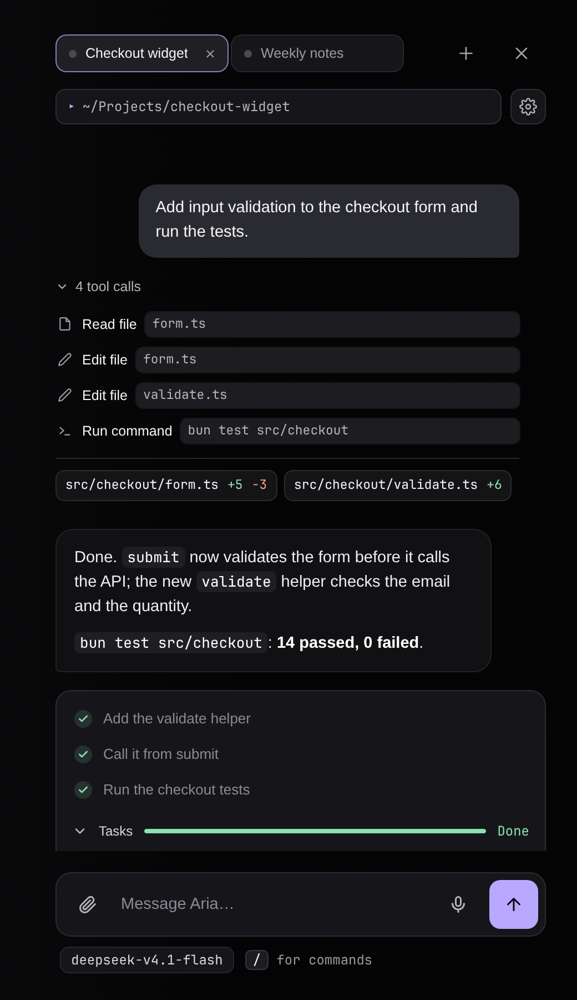
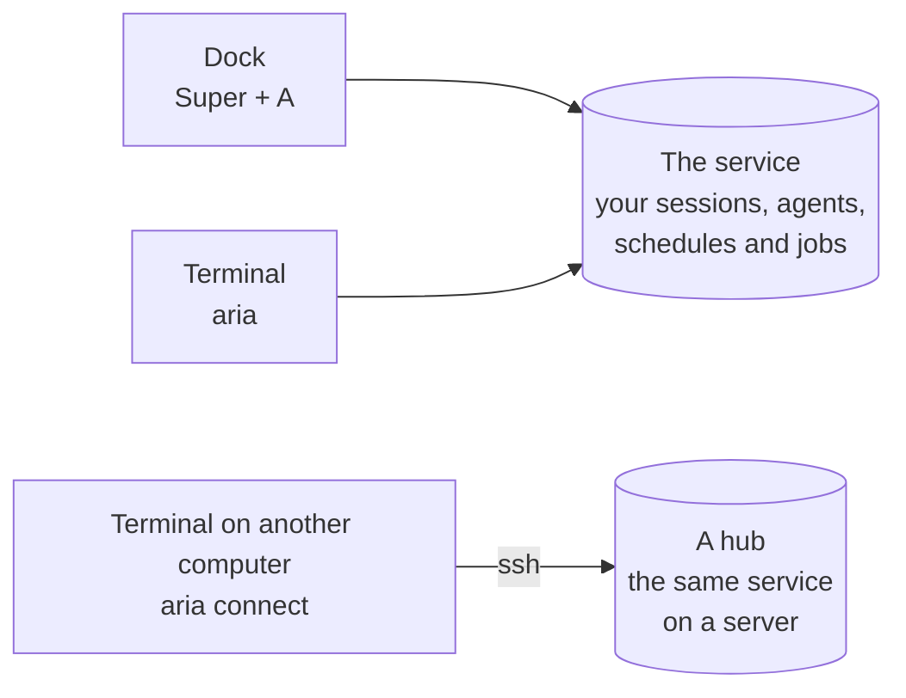

<div align="center">

# Aria (A Really Intelligent Assistant)

**A personal assistant that lives on your desktop.**
Press <kbd>Super</kbd> + <kbd>A</kbd> (<kbd>Option</kbd> + <kbd>Space</kbd> on a Mac) and it opens over whatever you are doing:
it reads your files, runs commands, plans and delegates, inside limits you can see.

[](https://github.com/i-montes/aria/releases/latest)
[](LICENSE)




</div>

## Install

```sh
curl -fsSL https://github.com/i-montes/aria/releases/latest/download/install.sh | sh
```

Then press <kbd>Super</kbd> + <kbd>A</kbd> (<kbd>Option</kbd> + <kbd>Space</kbd> on a Mac) and the setup walks you through connecting a provider.

| System | You need |
|---|---|
| **Omarchy** | Hyprland 0.56 or newer with the Lua configuration, and Node 22.19 or newer |
| **macOS** | macOS 12 or newer, and Node 22.19 or newer. A release may not include the Mac binary; if it does not, [build it from a clone](docs/guide/getting-started.md#from-a-clone) |
| **Linux server** | Not this command: a server with no window is set up from a clone of the repository, see [running Aria on a server](docs/guide/hub.md) |

It never edits your Hyprland configuration. It asks for `sudo` only to install missing system packages on Omarchy, and never on a Mac. An update normally waits until the dock is hidden and nothing is running.
A specific version, a build of your own, updating and uninstalling are in [getting started](docs/guide/getting-started.md).

## Three ways to use it



| Way in | What it is |
|---|---|
| **The dock** | A column on the right of your screen, with your sessions as tabs. [Guide](docs/guide/dock.md) |
| **The terminal** | `aria` shows the same sessions as a list and a conversation. Closing it stops nothing. [Guide](docs/guide/terminal.md) |
| **A hub** | The service on an always-on server. Connect from another computer over ssh; background work and read-only scheduled tasks go on while your laptop is off. [Guide](docs/guide/hub.md) |

The dock and the terminal are windows onto one **service** that owns your sessions. Closing either never stops work in progress.

## What you get

| | What it does |
|---|---|
| **Chat** | Up to eight sessions as tabs; the ones you are not looking at keep working. Models from OpenCode Go, Anthropic with an API key, or your Claude plan. [The agent](docs/guide/agent.md) |
| **Plan and delegate** | Experts for backend, frontend, research, review and security, subagents you can watch, and **slice** for big work: a few questions, a plan you approve, then a phase built test first. [The agent](docs/guide/agent.md#slice-plan-first-then-build) |
| **Work without you** | Scheduled tasks you ask for in plain words, dev servers and long jobs in the background, notifications only when nobody is looking. [Automation](docs/guide/automation.md) |
| **Stay in control** | On Linux commands run in a sandbox (a Mac has none yet, so each command asks first), and a card asks before one leaves it. Keys are kept in the system keyring, and the model sees only the names of your secrets. [Safety](docs/guide/safety.md) |
| **Connect** | Notion, Tavily, the MCP servers your other apps already have, attachments, memory, and a headless browser to check the pages it builds. [Integrations](docs/guide/integrations.md) |
| **See and hear** | Dictation with Whisper on your own computer, a face that shows what Aria is doing, and a live trace of each turn (`/debug`). [Voice, face and trace](docs/guide/voice-and-face.md) |

## Documentation

| Use it | Look it up | Build it |
|---|---|---|
| [Getting started](docs/guide/getting-started.md) | [Commands and keys](docs/reference/commands.md) | [Development](docs/development.md) |
| [The dock](docs/guide/dock.md) | [Settings](docs/settings.md) | [Architecture](docs/architecture.md) |
| [Aria in a terminal](docs/guide/terminal.md) | [Data and paths](docs/reference/data-and-paths.md) | [Adding a provider](docs/adding-a-provider.md) |
| [Running Aria on a server](docs/guide/hub.md) | [What is pending](docs/pending.md) | [Design documents](docs/superpowers/specs/) |

The whole index, by question, is [docs/README.md](docs/README.md). What changed in each version is in [RELEASES.md](RELEASES.md).

## Build and contribute

```sh
cargo build --release
sh install/install.sh --local target/release/aria   # install the binary you built
cargo test --workspace && bun test ui && bun test extensions
```

[Development](docs/development.md) has the build libraries, the whole test map and the project's rules: everything in English, both platforms stay working, and conventional commits decide the version.

## License

[MIT](LICENSE)
